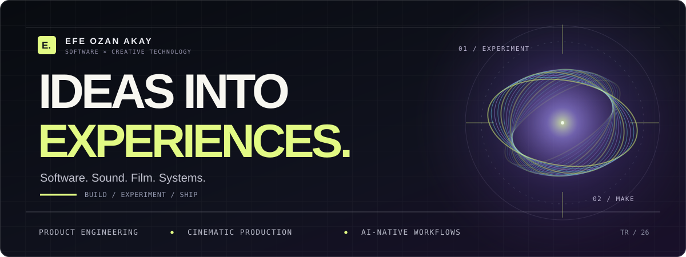
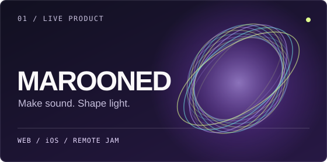
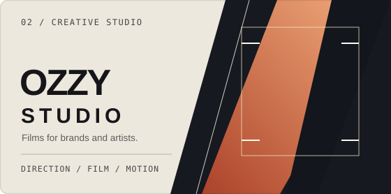
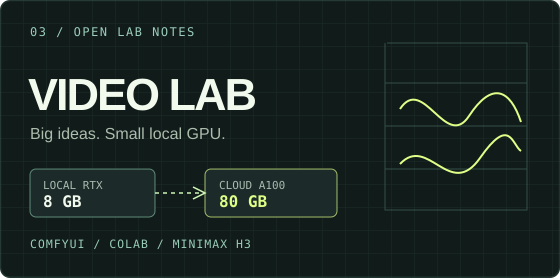
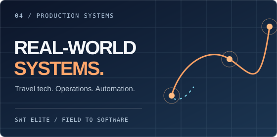

 

**Independent builder / Creative technologist / Founder of Ozzy Studio**

I design useful software, build expressive digital products and make moving images.
From a working prototype to the finished experience — I like owning the entire creative and technical loop.

**[Explore Marooned](https://marooned.app)** &nbsp;·&nbsp; **[View Ozzy Studio](https://ozzystudio.com)** &nbsp;·&nbsp; **[See my experiments](https://github.com/efeozanakay/colab-comfyui-h3-video-notes)**

Based in Antalya, Türkiye. Building across product engineering, creative production and AI-assisted workflows.

 

## 01 — Selected work

<table>
<tr>
<td width="50%" valign="top">
  
  <h3><a href="https://marooned.app">Marooned</a></h3>
  
An interactive audiovisual instrument: sculpt sound and light, explore atmospheric textures and play together through Remote Jam. Built for the web and packaged for iOS.

  
<strong>Interactive audio · Visual systems · Web + iOS</strong>

  
<a href="https://marooned.app">Launch web app ↗</a>

</td>
<td width="50%" valign="top">
  
  <h3><a href="https://ozzystudio.com">Ozzy Studio</a></h3>
  
Independent creative production for brands and artists. Cinematic product films, campaign visuals, music videos and motion-led stories — blending direction, design and modern production tools.

  
<strong>Creative direction · Film · Motion</strong>

  
<a href="https://ozzystudio.com">Explore the studio ↗</a>

</td>
</tr>
<tr>
<td width="50%" valign="top">
  
  <h3></h3>
  
Hands-on experiments in generative video, consistency and production pipelines. Taking an 8GB-VRAM laptop into cloud A100 workflows with Colab, ComfyUI and MiniMax H3 — with real settings and lessons documented.

  
<strong>ComfyUI · Colab · GPU workflows · Post-production</strong>

  

</td>
<td width="50%" valign="top">
  
  <h3><a href="https://swtelite.com">Real-world systems</a></h3>
  
Digital experiences and operational tooling for real travel workflows, including SWT Elite's corporate presence and evolving transfer-booking journey. Turning complex day-to-day work into clearer interfaces and processes.

  
<strong>Travel technology · Operations · Automation</strong>

  
<a href="https://swtelite.com">Visit SWT Elite ↗</a>

</td>
</tr>
</table>

Studio films and experiments are presented as creative work, not as claims of client campaign results. Some product and commercial codebases are private; the links above lead to public experiences or documentation.

 

## 02 — What I'm building with

<table>
<tr>
<td width="33%" valign="top">

**PRODUCTS & WEB**

`TypeScript` · `JavaScript` · `React` · `Next.js` · `Capacitor` · `Cloudflare`

Interfaces, deployment, release pipelines and hands-on product iteration.

</td>
<td width="33%" valign="top">

**SYSTEMS & AUTOMATION**

`Python` · `APIs` · `Data workflows` · `CI/CD` · `GitHub`

Operational tooling, spreadsheet transformation and practical integrations.

</td>
<td width="33%" valign="top">

**FILM & GENERATIVE MEDIA**

`ComfyUI` · `Colab` · `Remotion` · `FFmpeg` · `Blender`

Creative R&D, cinematic storytelling, sound and production workflows.

</td>
</tr>
</table>

## 03 — Public tools & field notes

Not everything I build is a public repository. These are a few tools and experiments you can actually inspect:

- **[Colab + ComfyUI video notes](https://github.com/efeozanakay/colab-comfyui-h3-video-notes)** — reproducible settings, model files, runtime lessons and GPU benchmarks from an actual production experiment.
- **[Flight Checker](https://github.com/efeozanakay/Flight-Checker)** — flight-data checks designed for operational validation.
- **[Pickup-time Sender](https://github.com/efeozanakay/Pickuptime-sender)** — grouping and preparing transfer pickup information.
- **[Reservation Data Transformation Tool](https://github.com/efeozanakay/reservation-data-transformation-tool)** — cleaning, validating and restructuring reservation spreadsheets.

 

### The best work happens between disciplines.

**A useful system should feel thoughtfully made. A beautiful experience should actually work.**

[**See the studio**](https://ozzystudio.com) &nbsp;·&nbsp; [**Try Marooned**](https://marooned.app) &nbsp;·&nbsp; [**Get in touch**](mailto:hello@ozzystudio.com)

© Efe Ozan Akay · Made with curiosity, tested in the real world.

