**Software builder · Automation enthusiast · Creative technologist**

Based in Antalya, Türkiye

---

### `01 / ABOUT`

I build **practical software for real operational problems** — from flight validation and reservation workflows to web products and creative production systems.

My background in tourism operations shapes how I work: **understand the workflow, remove the friction, then build something people can actually use.**

### `02 / SELECTED WORK`

<table>
  <tr>
    <td width="50%" valign="top">
      <h3><a href="https://github.com/efeozanakay/Flight-Checker">✈️ FlightChecker</a></h3>
      
Validate flight schedules against live flight information and surface the discrepancies that matter.

      
<code>Next.js</code> <code>TypeScript</code> <code>FastAPI</code> <code>Python</code>

    </td>
    <td width="50%" valign="top">
      <h3><a href="https://github.com/efeozanakay/Pickuptime-sender">📨 Pickup Sender</a></h3>
      
Turn multi-hotel pickup PDFs into hotel-specific documents and streamline Outlook distribution.

      
<code>Python</code> <code>Streamlit</code> <code>PDF automation</code>

    </td>
  </tr>
  <tr>
    <td width="50%" valign="top">
      <h3><a href="https://github.com/efeozanakay/swt-elite-website">🌐 SWT ELITE Website</a></h3>
      
A production corporate website and evolving digital experience for a tourism services business.

      
<code>Next.js</code> <code>React</code> <code>Tailwind CSS</code>

    </td>
    <td width="50%" valign="top">
      <h3><a href="https://github.com/efeozanakay/ozzy-studio">🎬 Ozzy Studio</a></h3>
      
A creative production studio's web experience — bringing film, design and technology together.

      
<code>React</code> <code>Vite</code> <code>Creative technology</code>

    </td>
  </tr>
</table>

**More work:** [Reservation Data Transformation](https://github.com/efeozanakay/reservation-data-transformation-tool) · [ClientFinder](https://github.com/efeozanakay/client-finder) · [OZZY Creative Intelligence](https://github.com/efeozanakay/ozzy-creative-intelligence)

### `03 / TOOLKIT`

`Python` · `TypeScript` · `JavaScript` · `Next.js` · `React` · `FastAPI` · `Streamlit` · `Tailwind CSS` · `GitHub` · `Cloudflare`

### `04 / THE THROUGH LINE`

`UNDERSTAND THE PROBLEM` → `DESIGN THE WORKFLOW` → `BUILD & TEST` → `SHIP`

---

  Built around useful software, thoughtful design, and a curiosity for what comes next.

